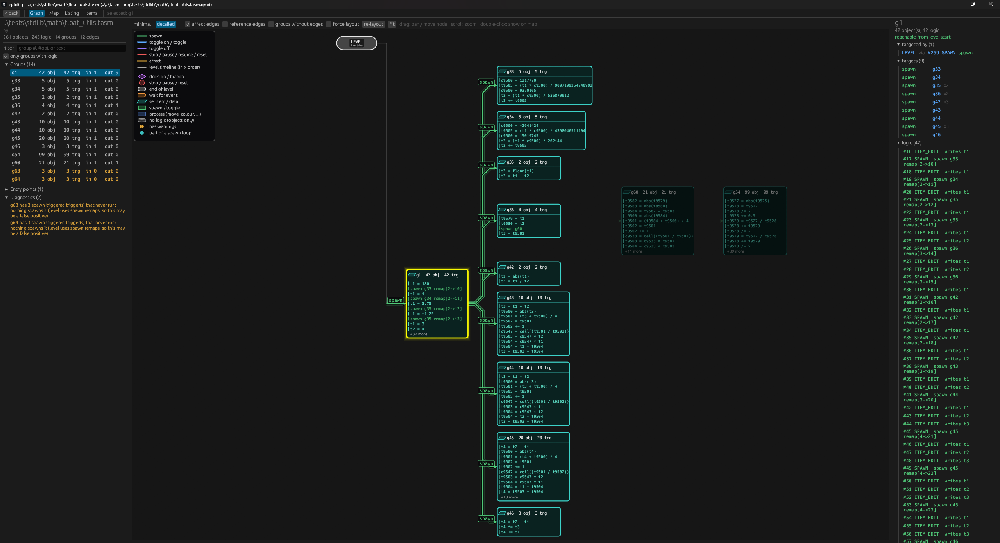

# GDDebug
A debugger for Geometry Dash levels independent from the game itself. This project attempts to recreate the environment of GD accurately enough to debug problems in levels with complex trigger setups.



## Dependencies

For this project to compile, the `gdlib` directory needs to be present alongside it:
```
this folder/
    gdlib/  <-- compile dependency
    gddbg/
``` 

The latest **in-development** version of gdlib is used here (i.e. the latest commit on the `dev` branch from the gdlib repo).
